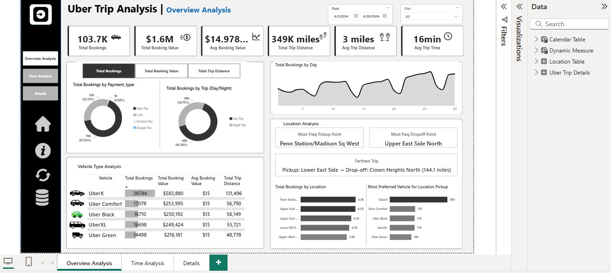
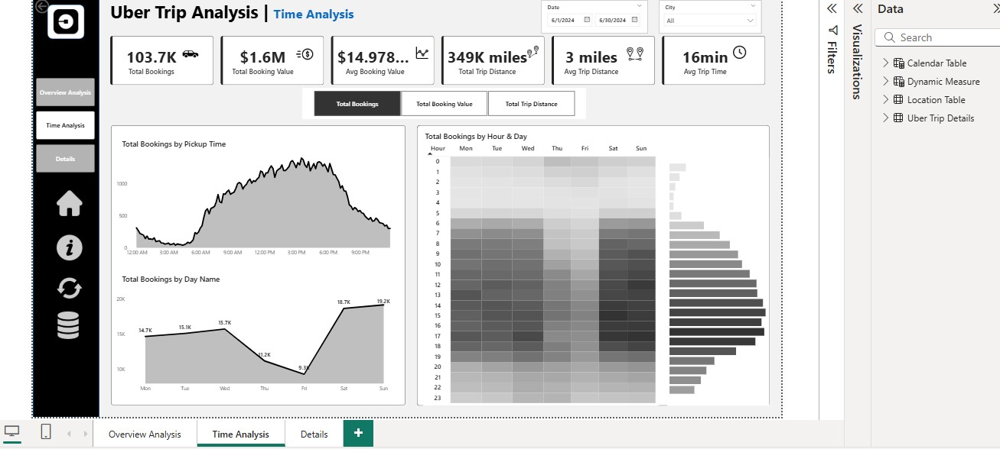
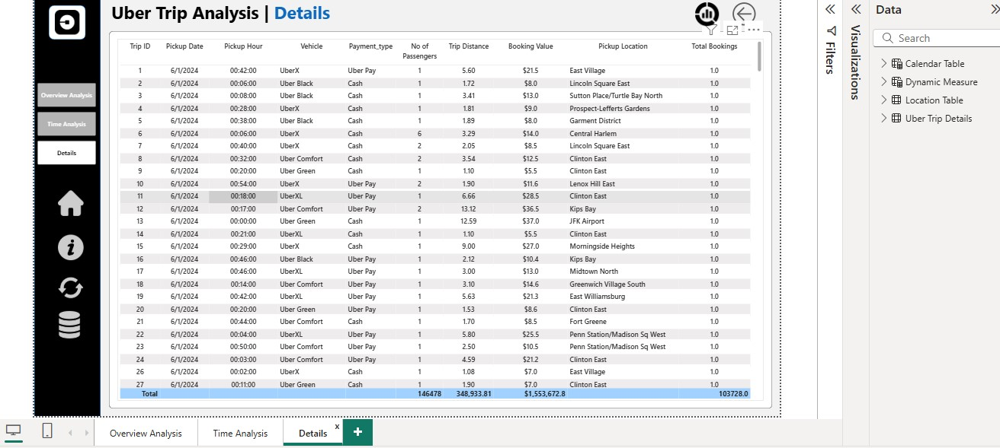

# Uber Trip Analysis: Power BI Dashboard


An interactive **Power BI dashboard** built on **103,728 Uber trips (June 2024)**. It answers three operations questions: *when* is demand highest, *where* do trips start and end, and *which* vehicle types and payment methods are used most.

The dashboard follows a business-requirement brief, included in [`docs/business_requirements.pdf`](docs/business_requirements.pdf).

## Dashboard preview

**Overview analysis**: KPIs, payment split, vehicle-type table and location analysis



**Time analysis**: bookings by hour, by weekday, and an hour-by-day heatmap



**Details**: trip-level table for drilling into individual bookings



## Headline KPIs

| KPI | Value |
|---|---|
| Total bookings | **103.7K** |
| Total booking value | **$1.55M** (fare + surge fee) |
| Average booking value | **$14.98** |
| Total trip distance | **348.9K miles** |
| Average trip distance | **3.4 miles** |
| Average trip time | **16 minutes** |

## Key insights

- **Demand peaks mid-afternoon.** The four busiest hours are **2 PM to 6 PM** (about 7,600 to 7,900 trips per hour, with 3 PM the highest). The quietest hours are **2 AM to 5 AM** (around 330 to 480 trips per hour).
- **Weekday totals are misleading.** June 2024 has five Saturdays and five Sundays but only four of every other weekday, so weekends look busiest in a raw total. Per day, **Wednesday is the busiest (about 3,930 trips)** and **Thursday and Friday are the quietest (about 2,790 and 2,320)**.
- **UberX leads.** It makes up **37.4%** of trips (38,744). The other four vehicle types each take 14 to 16.5%, and the average booking value is almost the same (about $15) across all of them.
- **Digital payment dominates.** Uber Pay covers **67.0%** of trips and cash **32.2%**. Amazon Pay and Google Pay together are under 1%.
- **Long trips matter for revenue.** The longest 10% of trips by distance bring in **25.1%** of total booking value.
- **Busiest locations.** Top pickup points are **Penn Station/Madison Sq West** (4,475 trips) and **Upper East Side North** (4,459). The most common drop-off is **Upper East Side North** (4,024).
- **Data-quality flag.** The "farthest trip" card shows **144.1 miles** from Lower East Side to Crown Heights North. Both are in New York City, so this is almost certainly an outlier or entry error worth validating.

## Business objective

Help an operations analyst to:

- spot peak and off-peak hours so drivers can be positioned where demand is,
- track the core metrics (bookings, booking value, distance and trip time),
- understand location and vehicle-type patterns to support pricing and allocation decisions.

## Data

Simulated Uber trip data covering **1 to 30 June 2024**.

**`data/trip_details.csv`**: 103,728 rows

| Column | Meaning |
|---|---|
| `Trip ID` | Unique trip number |
| `Pickup Time`, `Drop Off Time` | Start and end timestamps |
| `passenger_count` | Passengers on the trip |
| `trip_distance` | Distance in miles |
| `PULocationID`, `DOLocationID` | Pickup and drop-off zone IDs (join to the location table) |
| `fare_amount`, `Surge Fee` | Fare and surge charge in dollars (**booking value = fare + surge fee**) |
| `Vehicle` | UberX, Uber Comfort, Uber Black, UberXL, Uber Green |
| `Payment_type` | Uber Pay, Cash, Amazon Pay, Google Pay |

**`data/location_table.csv`**: 265 zones (`LocationID`, `Location`, `City`)

## Dashboard features

- **Measure selector**: one click switches the charts between total bookings, total booking value and total trip distance.
- **Slicers** for date range and city.
- **Overview page**: KPI cards, payment-type and day/night donuts, vehicle-type table, bookings by day, location analysis (top pickups, top drop-offs, farthest trip, preferred vehicle per pickup location).
- **Time page**: bookings by pickup time, by day name, and an hour-by-weekday heatmap.
- **Details page**: full trip table with totals.

## Project structure

```
uber-trip-analysis/
├── dashboards/
│   └── uber_trip_analysis.pbix      # Power BI report (open in Power BI Desktop)
├── data/
│   ├── trip_details.csv             # 103,728 trips
│   └── location_table.csv           # 265 pickup / drop-off zones
├── docs/
│   └── business_requirements.pdf    # brief the dashboard was built against
├── images/                          # dashboard screenshots
└── README.md
```

## How to use

1. Clone the repository:
   ```bash
   git clone https://github.com/MohanNellore/Uber-Trip-Analysis.git
   ```
2. Open `dashboards/uber_trip_analysis.pbix` in **Power BI Desktop** (Windows).
3. If Power BI asks for the data location, point it at the files in `data/`.
4. Use the slicers and the measure selector to explore.

## Possible improvements

- Show **average trips per day** by weekday instead of totals, to remove the five-weekend-days effect.
- Add an outlier filter for implausible trip distances.
- Compare surge-fee trips with normal trips by hour and location.

## Contact

**Mohan Nellore**
- Email: mohannellore17@gmail.com
- LinkedIn: [linkedin.com/in/mohan-nlr](https://linkedin.com/in/mohan-nlr)
- GitHub: [github.com/MohanNellore](https://github.com/MohanNellore)
